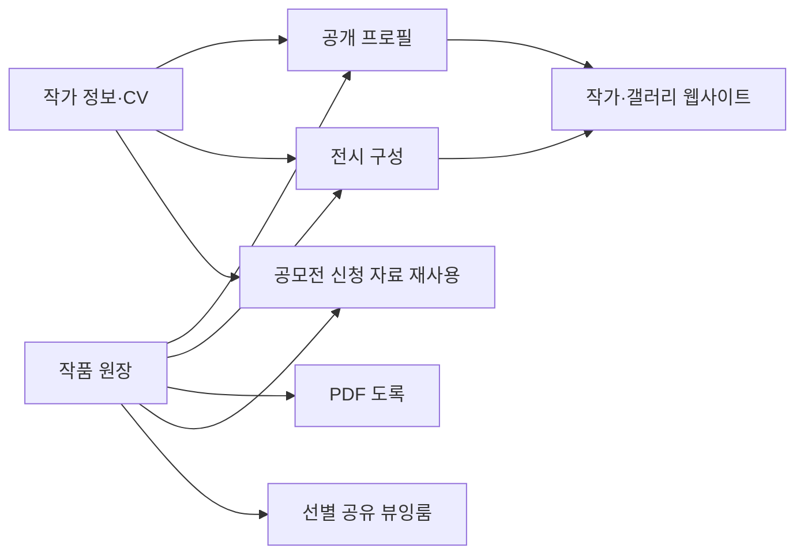

# Artspoon → ASCA 회원 작가 아카이브 벤치마크

관찰일: 2026-10-18. ASCA 비교 기준: main `68418679`. 상태: 공개 서비스 조사·REA
정적 분석·적용 제안 완료. 아래 제안은 구현 완료를 뜻하지 않는다.

## 결론

ASCA가 우선 참고할 점은 **작품과 이력을 한 번 정리해 프로필·전시·공모전에
재사용하는 흐름**이다. 현재 ASCA에는 공개 조회와 신규 비공개 등록이 있으므로
다음 작업은 내 작품 관리·초안 재편집, 관리자 검토·게시, 데이터 재사용을 완성하는
순서가 적절하다.

Artspoon의 고객 판매 기능보다 ASCA의 협회 기록·서예 전문 정보·인증 근거를
앞세운다. 한자 제목·아호·사사·서체·석문·풀이·출전·낙관은 유지하고, 공개 문의는
협회를 거친다.

## 조사 범위와 증거 수준

- **화면 관찰**: gstack으로 공개 화면을 열어 로딩 후 목록, 검색 입력 후보,
  페이지 이동 컨트롤, 공모전 상세 진입, 작가 사이트의 작품·CV 페이지를 확인했다.
- **제품 소개 주장**: 자동 동기화·PDF 생성·원클릭 신청·심사·비공개 뷰잉룸은 공식
  소개 내용이다. 로그인한 관리 화면이나 실제 신청·승인·결제·PDF 생성까지
  수행하지 않았다.
- **정적 관찰**: 브라우저가 공개한 배포 manifest와 선택한 JS를 gstack으로
  내려받아 REA에서 실행 없이 분석했다. 등록된 경로는 구현 후보의 증거이며 접근
  권한·실제 기능 작동을 보증하지 않는다.
- **ASCA 제안**: 위 관찰을 ASCA의 현재 코드·DB 계약에 맞춰 해석한 설계 제안이다.

로그인, 계정 생성, 결제, 실제 공모전 접수, 타인의 비공개 자료 접근은 수행하지
않았다. Artspoon의 내부 DB·서버 코드·실제 권한 구현·특정 프레임워크 버전은
확인하지 않았다.

## Artspoon의 제품 구조

공개 내비게이션은 제품 기능과 대상 고객을 구분한다. 기능은
작품·전시·CV·프로필·웹사이트· 공모전·뷰잉룸으로 나누고, 솔루션은 신진 작가·중견
작가·갤러리·공모전 주최자로 나눈다. 판매 보고서와 고객 관계는 관찰 당시 `Soon`
표시였으므로 제공 중인 기능으로 집계하지 않는다. 출처:
[홈](https://artspoon.io/).

다음은 제품 소개를 바탕으로 재구성한 **개념적 기능 연결도**이며 실제 DB ERD가
아니다.

### 기능별 관찰과 해석

| 영역          | 확인 내용                                                          | 증거 수준                 | ASCA 시사점                                                           |
| ------------- | ------------------------------------------------------------------ | ------------------------- | --------------------------------------------------------------------- |
| 작가 발견     | 추천 작가 영역, 이름 검색 입력 후보, 작가 카드, 페이지 이동        | 공개 화면 관찰            | 작가명·아호·한자 검색을 유지하고 실제 데이터 기반 필터를 제공         |
| 작품 원장     | 개별·일괄 등록, 폴더, 필터, 연결 정보 업데이트                     | 공식 제품 소개            | 등록 후 수정·재사용할 수 있는 회원 작업 공간 필요                     |
| 공개 프로필   | 작품·CV가 갱신되면 프로필에도 반영된다고 안내                      | 공식 제품 소개            | 프로필용 작품 복제보다 같은 작품 ID를 재사용                          |
| CV            | 수상·전시를 연도별로 구성한 공개 CV를 관찰. PDF는 소개에서 안내    | 화면 관찰 + 제품 소개     | artist_records 기반 연도별 이력과 PDF 내보내기 후보                   |
| 전시          | 기존 작품·작가를 선택해 전시와 연결하고 웹사이트에 반영한다고 안내 | 공식 제품 소개            | 기존 exhibition_artists·exhibition_artworks 재사용                    |
| 공모전        | 접수 상태, 남은 기간, 분야, 상세 안내·주최자·신청 진입점을 관찰    | 공개 화면 관찰            | 2단계 접수의 정보 구조 참고                                           |
| 공모전 운영   | 신청자 대시보드, 상태 관리, 맞춤 심사 기준·외부 심사위원 안내      | 공식 제품 소개, 예시 화면 | 협회 접수·심사 프로세스의 후속 설계 참고. 실사용 검증 아님            |
| 작가 웹사이트 | 독립 서브도메인에서 작품·전시·CV·소개 연결, 작품 시리즈 분류 관찰  | 공개 화면 관찰            | 같은 데이터로 공개 화면을 구성하는 원칙 참고. 별도 사이트 빌더는 보류 |
| 비공개 뷰잉룸 | 작품 선별 링크, 고객별 구성, 일정 추가·클릭 분석을 안내            | 공식 제품 소개            | 현재 범위에서 보류. 비공개 URL만으로 보안을 보장한다고 해석하지 않음  |

근거 페이지: [작가 탐색](https://artspoon.io/search),
[작품 관리](https://artspoon.io/products/artworkmanagement),
[프로필](https://artspoon.io/products/profilepage),
[CV](https://artspoon.io/products/artistcv),
[전시](https://artspoon.io/products/exhibitions),
[신청 소개](https://artspoon.io/products/contestapply),
[주최자 소개](https://artspoon.io/products/host-open-calls/detail),
[뷰잉룸](https://artspoon.io/products/privateviewingroom),
[공개 작가 사이트](https://bae.artspoon.io/),
[작품](https://bae.artspoon.io/artworks), [CV 표본](https://bae.artspoon.io/cv).

주최자 소개의 신청자·점수·처리 현황은 마케팅 예시 화면이다. 실운영 통계나 심사
엔진의 정확성·공정성을 관찰한 것으로 해석하지 않는다. 프로필 검색 노출 향상도
효과를 측정한 것이 아니다.

## REA로 확인한 배포 구조

관찰한 Next.js build ID는 `nBXuvB-Ds447Cwym0gP_l`이다. 배포된
`_buildManifest.js`, `__NEXT_P`, 페이지 chunk와 `__NEXT_DATA__`는 Pages Router
계열의 프런트 구조를 뒷받침한다. REA가 선택 번들의 Webpack factory를 복원한
결과도 일치한다. 서버 아키텍처·DB 제품은 알 수 없다.

공개 manifest에서 확인한 경로군:

- 공개 발견·홍보: `/search`, `/contest`, `/products/*`, `/solutions/*`
- 작가 작업 공간 후보: `/inventory`, `/artistprofile/cv`, `/portfolio`,
  `/exhibitions/*`
- 전시·공모전 운영 후보: `/contest-management/*`, `/contest/evaluation/[token]`,
  `/artfair/*`
- 공개 사이트 후보: `/web/[domain]/*`, `/showcase/[domain]/[iid]`,
  `/catalog/[domain]`
- 선별 공유·사이트 설정 후보: `/privateshare/*`, `/website/settings/*`

작업 공간·평가·토큰 경로는 manifest에서만 확인했고 방문하거나 토큰을 생성하지
않았다. 경로의 존재는 활성 기능·권한·보안의 증명이 아니다. 공개 작가
서브도메인을 실제로 관찰했지만, 그 호스트가 내부 `/web/[domain]` 경로로 변환되는
방식은 확인하지 않았다.

### 정적 분석 근거

- 전체 분석 parent Evidence:
  `ev_ec6fbc0e1f33558ff60e86cd5636d8be3a7484b2e81d58fff743adcc5055d49d`
- 요약 Evidence:
  `ev_32016135dc6fecdbb0d69d2959932c102b48fd87296680d1554a03dd071107f4`
- 선택 artifact root SHA-256:
  `434f581fbb1321aed7123026cfd47b4d3993fe95e09afb2b5b1c9c6d9593da89`
- 검색 bundle 식별 Evidence:
  `ev_a9b3005db9b1dd170aca96b3c2080f6e4f3f04a6f81ac756ad34238569c099f1`
- 검색 factory `64382` Evidence:
  `ev_f136b737f5290154ff5d67539a84c5d648b5092ff4bb85927b92a1bd5d7619e7`
  - `search.js` 첫 줄 column 2536–13687의 Webpack factory 범위
  - bundle SHA-256:
    `c3fe694c18a0ffdcac069995b329ad9ecadbdb888ac8eb911a411cfb81e6b873`
- 공모전 bundle 식별 Evidence:
  `ev_03ced7f5af7995066c70415b3258794f59babd54371e65821294dd93aa270ed4`
  - SHA-256: `d21babe001c79a01973a57f048cf217292792c6dbf3811e4b55ceb2dae8b0f4d`

입력은 선택한 공개 파일에 한정된다. 파서 오류는 없었지만 application graph는
partial, semantic coverage는 unknown이다. 누락된 공통 chunk·동적 호출·미확인
참조가 있으며, 정적 모듈 복원이 실제 실행·전체 소스 복원·전체 기능 검증을
의미하지 않는다.

임시 근거는 `/private/tmp/artspoon-benchmark/`의 `rea-evidence-summary.json`,
`artifact-hashes.json`, `public-js/`에 보관했다. 임시 디렉터리는 사라질 수
있으므로 재조사 시 실제 build ID와 SHA-256을 다시 확인한다. 타사 bundle·작품
이미지는 저장소에 포함하지 않는다.

## ASCA의 현재 구현과 차이

| 항목                | 확인한 ASCA 코드·계약                                                            | 판단                                                                        |
| ------------------- | -------------------------------------------------------------------------------- | --------------------------------------------------------------------------- |
| 공개 작가·작품·이력 | `app/archive/`, `lib/archive/queries.ts`                                         | 이미 존재. 새 목록을 또 만드는 것보다 탐색 개선에 집중                      |
| 초안·검토 요청      | `components/archive/submission-form.tsx`, `app/api/archive/submissions/route.ts` | 신규 비공개 등록만 있음. 초안 재편집·내 작품 관리 필요                      |
| 게시·인증           | `artist_records.is_asca_verified`, 작품 status                                   | 서로 다른 상태. 검토·게시·인증을 한 버튼으로 묶지 않음                      |
| 원본·미게시 이미지  | archive-private, 서버 파생본 생성, 상대 경로                                     | 공개 파생본 게시·회수 수명주기와 검토용 미리보기 필요                       |
| 공개 프로필         | `components/archive/artist-profile.tsx`                                          | 작품·이력 탭 존재. 공유 URL·메타데이터·CV 출력 확장 후보                    |
| 탐색                | URL 기반 검색·페이지 구분, 서체·등급 텍스트 필터                                 | 이미 재현 가능한 URL이 있음. 공식 분류 확정 후 선택형 필터로 개선           |
| 전시 연결           | 기존 junction 테이블 있음                                                        | 새 작품 복제 없이 같은 artwork_id 연결                                      |
| 공모전              | `app/contests/`, `lib/api/contests.ts`에 레거시 코드 존재                        | 코드 존재를 운영 스키마·완성된 접수 기능으로 간주하지 않음. 2단계 계약 필요 |
| 공개 문의           | 협회 이메일로 연결, 작가 연락처 별도 비공개                                      | Artspoon 공개 작가 사이트의 직접 연락처 방식을 그대로 채택하지 않음         |

DB 타입의 기준은 `lib/types/database.generated.ts`와 `supabase/migrations`다.
기존 Drizzle 정의 전체를 `db:push`해 운영 스키마를 맞추지 않는다. 기존
`contests` 호출을 아카이브에 바로 붙이기 전에 실제 테이블·RLS·신청 계약을
확인해야 한다.

## 적용 우선순위와 완료 조건

### P0 — 등록에서 공개까지 운영 흐름 완성

**내 작품 작업 공간**: 제안 경로 `/archive/my`, 초안 편집 화면. 초안·검토
대기·게시 상태와 마지막 저장 시각, 필수 정보 누락, 보완 요청 사유를 표시한다.
실제 저장 성공 응답만 저장 완료로 안내하고, 실패 시 입력을 유지하며 재시도할 수
있게 한다. 중복 제출 방지를 위한 요청 식별자와 서버 멱등 처리를 함께 설계한다.

**협회 검토 화면**: 제안 경로 `/admin/archive/reviews`. 작품
이미지·석문·풀이·규격과 이력의 출처·확인 근거를 한 화면에서 검토한다. 검토용
비공개 이미지는 권한 확인 후 제한된 수명의 URL로 제공한다. 원본 key·연락처를
공개 응답이나 공유 페이지에 포함하지 않는다.

**게시·회수 서비스**: 기존 private 파생본을 승인 후 공개하고, 게시 취소·작가
비공개 전환 시 공개 사본을 회수한다. DB status만 바꾸는 방식은 금지한다.
재시도·부분 실패·감사 기록과 CDN 캐시의 회수 한계를 포함한 운영 계약이 먼저
필요하다.

완료 조건:

- 타인의 artist_id·artwork_id를 바꿔도 조회·수정·미리보기가 거부된다.
- 일반 작가는 게시·협회 인증 값을 변경할 수 없다. 인증은 근거와 승인자를
  기록한다.
- 초안 수정은 안전하게 재개된다. 검토 중 수정 허용 여부와 보완 요청 상태를
  명확히 정한다.
- 게시된 작품의 수정이 승인 전에 공개 화면에 바로 반영되지 않는다. 이를 위한
  수정본/승인본 분리 방식을 먼저 설계하고, 기존 status 컬럼만으로 해결됐다고
  주장하지 않는다.
- 게시·회수의 부분 실패를 재현하고 미게시 자료가 공개 버킷에 잔류하지 않도록
  복구한다.

### P1 — 한 번 입력한 정보를 여러 화면에 재사용

**공개 탐색**: 공식 서체·등급 목록이 확정되면 선택형 필터와 적용 필터 칩을
제공한다. URL·뒤로 가기·공유 시 조건을 보존한다. 인증된 이력 유무와 작가의
등급을 구분하고, 검색 결과 없음·초기 로딩·통신 실패를 다른 상태로 표시한다.

**프로필·CV**: 연도·유형·출처를 기준으로 `artist_records`를 정리한다. 공개 CV와
PDF에는 공개 가능한 내용만 포함하고 확인된 이력과 자기 신고 이력을 구분한다.
공개 프로필의 제목· 설명·공유 이미지는 해당 공개 작가 기준으로 생성한다. SEO
순위 상승을 보장하지 않는다.

**작품·전시 재사용**: 전시에서 기존 작품을 선택해 junction으로 연결하고, 작가
페이지에서 연결 전시를 볼 수 있게 한다. 프로필·전시·도록마다 제목·규격·이미지를
복제하지 않는다. 도록과 작품 묶음은 별도 모델 정의 후 추가하며 현재 없는
소장처·도록 데이터를 만들지 않는다.

완료 조건: 같은 작품의 승인된 정보가 연결 화면에서 일관되고, 한자·영문·세로
족자·가로 횡액이 웹과 PDF에서 보존된다. 원본·비공개 정보는 공개 출력에서
제외된다.

### P2 — 공모전 접수와 협회 기록 연결

공모전 상세는 일정·자격·서체/부문·규격·제출 수량·심사·결과·문의로 구분하고, 기존
작품 선택 → 필수 정보 확인 → 신청 내용 확인 → 접수증의 흐름을 설계한다. 회원과
작품을 재입력시키지 않는다.

기존 `contest_ref`는 임시 텍스트 참조다. 실제 공모전·회차·부문·신청·신청 작품
관계는 2단계 마이그레이션으로 설계한다. 접수 당시 제출 자료 snapshot 또는
revision을 고정해, 나중의 작품 수정이 심사 자료를 바꾸지 않도록 한다. 접수
상태와 작품 게시 상태도 구분한다. 심사위원은 배정된 신청만 읽고, 외부 심사
링크는 만료·회수·접근 기록을 갖춰야 한다.

완료 조건: 중복 접수·자격 미충족·마감 시각·수정 기한을 서버에서 검사하고, 결과
확정 후 협회가 확인한 수상/출품 이력으로 연결한다. 제출만으로 자동 인증하지
않는다. 전시 관람 예약은 현재 계획대로 Luma를 연결한다.

### 보류 — 판매·결제·CRM·사이트 빌더·VIP 뷰잉룸

협회 아카이브의 우선 목표와 현재 범위를 넘어선다. 폴더·작품 묶음도 도록/전시
작업의 실제 사용량을 본 뒤 도입한다. Artspoon의 기능 전체를 처음부터 복제하는
계획은 세우지 않는다. 서브도메인은 기존 기획대로 별도 배포·호스트 라우팅 검증
작업으로 다룬다.

## 그대로 따라 하지 않을 점

- **일정 중복**: 관찰한
  [Gallery ION 공고](https://artspoon.io/contest/detail/gallery-ion-opening-group-exhibition-2026)는
  구조화된 신청 기간에는 2026-10-27, 본문 일정에는 2026-10-20을 마감일로
  표기했다. 어느 쪽이 실제 마감일인지는 확인하지 않았다. ASCA는 DB 마감 시각을
  기준으로 표시·D-day· 서버 접수 판정을 함께 계산하고, 본문에 중복 입력하지
  않도록 한다. 시간대는 명시한다.
- **번역 키 노출**: 관찰한 [공모전 목록](https://artspoon.io/contest) 일부
  분야에 `mediaCategory.OTHER`가 표시됐다. ASCA는 번역 키 일치 검사와 실제 4개
  언어 화면 검사를 함께 수행하고, 콘텐츠의 한국어 폴백과 번역 누락을 구분한다.
- **초기 0 표시**: 공모전 목록은 초기 관찰에서 0으로 보였다가 로딩 후 값이
  채워졌다. ASCA는 로딩이 끝나기 전에 결과 없음으로 안내하지 않는다.
- **연락처 공개·상업 지표**: 표본 작가 사이트는 개인 연락처·작품 가격·판매
  상태를 공개한다. ASCA는 연락처 비공개·협회 문의 원칙을 유지하고 가격·구매·고객
  추적 UI는 추가하지 않는다.
- **내비게이션 접근성**: 작가 목록에서 일부 진입점은 링크 대신 클릭 가능한
  div/button으로 관찰됐다. ASCA의 작가·작품 진입은 현재처럼 실제 Link를 유지하고
  키보드·새 탭 동작을 보장한다.

색·글꼴·간격은 [DESIGN.md](../02-design/DESIGN.md)의 Ink System을 유지한다.
서체·인증 배지는 시맨틱 토큰을 사용하고, 실제 작품 이미지는 자르지 않는다.

## 다음 구현 단위

첫 후속 구현은 **내 작품 관리 + 초안 편집 + 협회 검토/게시**로 묶는 것이
적절하다. 수정본 승인 계약·비공개 이미지 검토·공개 사본 수명주기·멱등 처리를
먼저 설계한 뒤, 공개 프로필 재사용·PDF·공모전 접수로 확장한다. 이 문서는 해당
작업의 입력이며 새 API·DB 테이블·UI·운영 설정을 이번 조사에서 추가하지 않았다.
