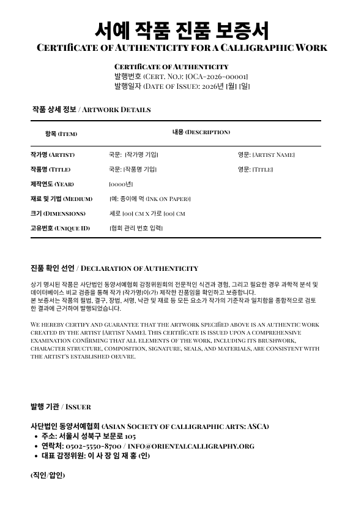
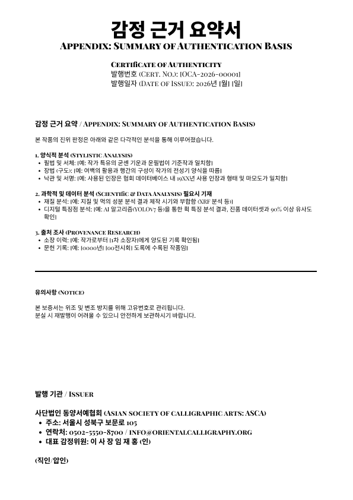
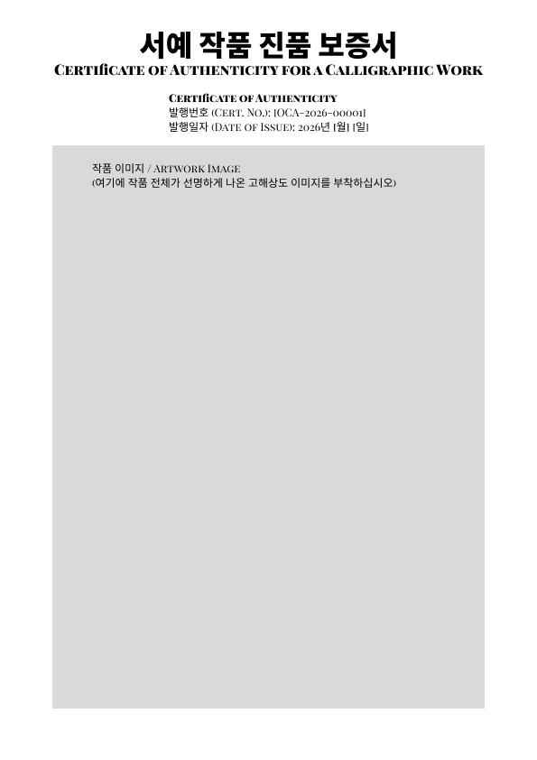

# 작품 감정 및 보증서 발행 규정

> [시행 2026. 2. 13.] [제1호 시행령, 2026. 2. 13., 신규 개정]

## 제1장 총칙

### 제1조 (목적)

본 규정은 **「미술진흥법」 및 관련 법령을 준수**하며, 사단법인 동양서예협회(이하
"협회")가 주관하는 전시 및 판매 작품의 **진위 감정 및 공정한 시가 감정(가치
평가) 및 보증서 발행**에 관한 절차와 기준을 정함으로써, **법적 공신력을
확보**하고 미술 시장의 투명성을 제공하며 구매자의 권익을 보호하며 한국 서예의
올바른 가치 평가를 **선도적**으로 확립함을 목적으로 한다.

### 제2조 (적용 범위)

본 규정은 협회가 기획, 주관 또는 후원하는 모든 전시회 및 판매 행사에서 거래되는
서예 작품에 적용한다.

## 제2장 감정위원회

### 제3조 (위원회 구성)

1. 작품의 공정한 감정을 위하여 **'감정위원회'(이하 "위원회")**를 둔다.
2. 위원회는 서예 미학 및 서체에 정통한 **안목 감정 위원**과 보존과학 및 데이터
   분석 전문가인 **과학 감정 위원**을 포함하여 5인 내외로 구성한다.
3. 협회는 감정의 전문성 및 공정성 유지를 위해 감정위원의 자격 요건을 명확히
   하고, **정기적인 심화 교육 및 보수 교육**을 의무적으로 시행한다.
4. 감정위원은 협회가 주관하는 전문 감정인 양성 과정을 이수하고 자격을 갱신해야
   한다.

## 제3장 감정 기준 및 절차

### 제4조 (감정 원칙)

감정은 전통적 안목 감정, 과학적 분석, 출처 조사를 종합하는 '다각적 접근법'을
원칙으로 한다.

### 제5조 (감정 방법)

위원회는 다음 각 호의 방법으로 진위를 판별한다.

1. **양식적 분석 (Stylistic Analysis):** 작가 고유의 필법(용필), 결구, 장법,
   낙관 및 서명을 기준작과 비교 분석한다.
2. **과학적 분석 (Scientific Analysis):** 필요시 종이, 먹, 인주의 성분 분석(XRF
   등) 및 연대 측정을 실시하여 재료의 시기적 일치 여부를 검증한다.
3. **인공지능 기반 분석:** 육안으로 식별하기 어려운 미세 패턴 및 획의 특징점은
   AI 알고리즘을 활용해 보조적으로 검증할 수 있다.
4. **출처 조사 (Provenance Research):** 전시 도록, 문헌 기록, 소장 이력 등을
   추적하여 작품의 이동 경로를 확인한다.

## 제4장 보증서의 발행 및 관리

### 제6조 (보증서 기재 사항)

진품으로 판정된 작품에 대해 발행하는 **보증서(Certificate of Authenticity)**에는
다음 사항을 필수적으로 기재해야 한다.

1. 작가명, 작품명, 제작년도
2. 재료 및 기법, 작품 크기 (세로×가로)
3. **작품의 전체 및 세부 고해상도 이미지**
4. 진품 확인 선언 (Declaration of Authenticity) 및 보증 내용
5. 발행 기관 정보, 발행일, 대표 감정위원의 서명 및 직인
6. 감정된 시가 감정가(Valuation Price) 및 가치 평가 기준일 (단, 의뢰인이 시가
   감정을 요청한 경우에 한함)

### 제7조 (고유번호 및 위조 방지)

1. 모든 보증서는 위·변조 방지를 위해 협회가 부여한 **고유식별번호(Unique ID)**로
   관리하며, 협회 데이터베이스에 영구 보존한다.
2. 발행하는 보증서 용지는 **워터마크 또는 복사 방지 패턴이 삽입된 특수 용지**를
   사용하며, 작품 이미지 위에 협회 **철인(압인)**을 날인하여 물리적 위·변조를
   방지해야 한다.

### 제8조 (데이터베이스 구축 및 활용 동의)

<!-- 검토 3: 제8조② 동의 간주 조항은 전문가 확인 필요 -->

1. 협회에 출품되거나 기증되어 감정 절차를 거친 작품의 고해상도 이미지 및 관련
   감정 데이터는 협회의 '진위 감정 AI 알고리즘 고도화' 및 '디지털 아카이브
   구축'을 위한 비상업적 연구 데이터로 영구 활용될 수 있다.
2. 작품의 출품자 또는 기증자는 제1항의 데이터베이스 구축 및 활용에 명시적으로
   동의한 것으로 간주하며, 이의를 제기할 수 없다.
3. 협회는 제1항에 따라 수집된 데이터를 작가 또는 소장자의 식별이 불가능한 형태로
   관리하며, 상업적 목적으로 외부에 유출하거나 활용하지 않는다.

### 제9조 (재발행)

<!-- 검토 2: 제9·10조가 조문이 아니라 작성 메모처럼 읽힘 -->

보증서는 원칙적으로 재발행하지 않는다. 단, 천재지변 등 불가피한 사유로 훼손된
경우, 소장자가 원본 파편 등 증빙을 제출하고 위원회의 심의를 거쳐 1회에 한해
재발행할 수 있다.

- **분실 시 처리:** 분실 시에는 **원칙적으로 재발행 불가**함을 재확인하고,
  예외적으로 재발행이 필요할 경우 분실 경위에 대한 소장자의 진술서 및 경찰서
  신고 확인서 등 **더욱 엄격한 증빙**과 **공고 절차**를 거쳐 재발행할 수 있도록
  명시해야 합니다. (이때 소정의 재발행 수수료를 규정할 수도 있습니다.)

### 제10조 (보증의 범위 및 면책)

- **책임 제한 명시:** 보증서의 효력은 “**발행 당시의 진위 여부에 한정**"함을
  명확히 합니다.
- **면책 사항 명시:** 다음 사유 발생 시 보증 효력이 상실되거나 협회가 책임을
  면할 수 있음을 명시합니다.
  - 보증서의 양도 시 협회에 신고하지 않은 경우
  - 작품의 훼손이나 변형이 발생한 경우
  - **보증서 원본을 제시하지 않는 경우**
  - 제3의 기관 감정 결과가 다르게 나왔을 때 협회의 재심의 절차 등.

## 부칙 (附則)

## 부칙 <제1호, 2026. 02.13>

### 제1조 (시행일)

이 규정은 공포한 날부터 시행한다.

